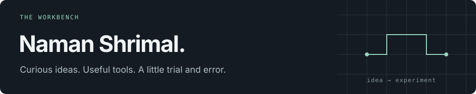

<!-- Edit this file directly. All artwork is stored in assets/; only the snake is generated. -->

<picture>
  <source media="(max-width: 600px)" srcset="assets/workbench-compact.svg">
  
</picture>

**[Main profile ↗ @Namans12](https://github.com/Namans12)** &nbsp; · &nbsp; [LinkedIn](https://www.linkedin.com/in/naman-shrimal12/) &nbsp; · &nbsp; [Email](mailto:namans1201@gmail.com)

 

*Building whatever I can until my tokens expire.*

### Hey, I'm Naman.

This is where I turn “what if?” into something I can run. I build web tools, play with interfaces, and explore how AI agents use tools and remember things.

Lately: **AI & ML · MCPs · agent loops · reinforcement learning**.
My main profile is **[Namans12](https://github.com/Namans12)**; this account is home to more of my experiments.

### On the workbench

| Project | The idea |
| :--- | :--- |
| **[clip-clap ↗](https://github.com/namans1201/clip-clap)** | Save, search, and organise text snippets, code, and diagrams. Next.js · Supabase |
| **[notion-like ↗](https://github.com/namans1201/notion-like)** | A block editor with slash commands, callouts, and syntax highlighting. React · TypeScript |
| **[llm ↗](https://github.com/namans1201/llm)** | Agent memory: what to keep, what to recall, and what to forget. Python · Neo4j · Groq |
| **[antigravity ↗](https://github.com/namans1201/antigravity)** | Particle fields and cursor interactions, explored five different ways. JavaScript · React |

[Explore the rest →](https://github.com/namans1201?tab=repositories)

<b>A few milestones along the way</b>

 

- Databricks Certified Data Engineer Associate
- Microsoft Azure AI Engineer Associate · Azure AI Fundamentals
- 2nd place — Formidium Hackathon · Honeywell Hackathon
- Finalist — Lumen Hackathon
- Published — Primera & Pegasus

### One contribution at a time

<picture>
  <source media="(prefers-color-scheme: dark)" srcset="https://raw.githubusercontent.com/namans1201/namans1201/output/snake-dark.svg">
  <source media="(prefers-color-scheme: light)" srcset="https://raw.githubusercontent.com/namans1201/namans1201/output/snake-light.svg">
  
</picture>

Always happy to talk AI, trade ideas, or build something useful. [Say hello →](mailto:namans1201@gmail.com)
