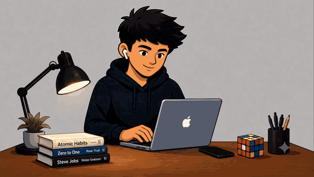
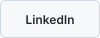
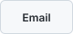
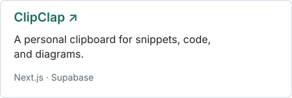
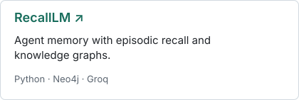
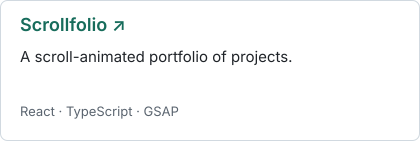
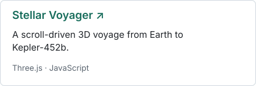
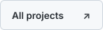
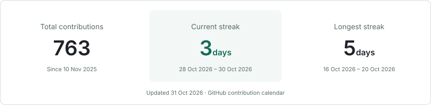

<!-- Edit this file directly. Buttons and project artwork: scripts/make_profile_assets.py. -->

<picture>
  <source media="(prefers-color-scheme: dark)" srcset="assets/intro-title-dark.svg">
  
</picture>

I build web tools and explore AI agents, memory, and the ideas in between.

 <a href="https://www.linkedin.com/in/naman-shrimal12/"><picture><source media="(prefers-color-scheme: dark)" srcset="assets/buttons/linkedin-dark.svg"></picture></a> <a href="mailto:namans1201@gmail.com"><picture><source media="(prefers-color-scheme: dark)" srcset="assets/buttons/email-dark.svg"></picture></a>

 

### What I'm exploring

MCP integrations · Agent workflows · Reinforcement learning

### Selected projects

<a href="https://github.com/namans1201/clip-clap"><picture><source media="(prefers-color-scheme: dark)" srcset="assets/projects/clipclap-dark-compact.svg"></picture></a> <a href="https://github.com/namans1201/RecallLM"><picture><source media="(prefers-color-scheme: dark)" srcset="assets/projects/recalllm-dark-compact.svg"></picture></a>

<a href="https://github.com/namans1201/Scrollfolio"><picture><source media="(prefers-color-scheme: dark)" srcset="assets/projects/scrollfolio-dark-compact.svg"></picture></a> <a href="https://github.com/namans1201/Stellar-Voyager"><picture><source media="(prefers-color-scheme: dark)" srcset="assets/projects/stellar-voyager-dark-compact.svg"></picture></a>

<a href="https://github.com/namans1201?tab=repositories"><picture><source media="(prefers-color-scheme: dark)" srcset="assets/buttons/repositories-dark.svg"></picture></a>

### Contributions & consistency

<picture>
  <source media="(max-width: 600px) and (prefers-color-scheme: dark)" srcset="assets/generated/stats-dark-compact.svg">
  <source media="(max-width: 600px)" srcset="assets/generated/stats-light-compact.svg">
  <source media="(prefers-color-scheme: dark)" srcset="assets/generated/stats-dark.svg">
  
</picture>

<picture>
  <source media="(prefers-color-scheme: dark)" srcset="https://raw.githubusercontent.com/namans1201/namans1201/output/snake-dark.svg">
  
</picture>

&nbsp; A few milestones along the way

 

- Databricks Certified Data Engineer Associate
- Microsoft Azure AI Engineer Associate · Azure AI Fundamentals
- 2nd place — Formidium Hackathon · Honeywell Hackathon
- Finalist — Lumen Hackathon
- Published — Primera & Pegasus

 

**Have an idea worth building? Let's talk.**

 <a href="mailto:namans1201@gmail.com"><picture><source media="(prefers-color-scheme: dark)" srcset="assets/buttons/email-dark.svg"></picture></a>

