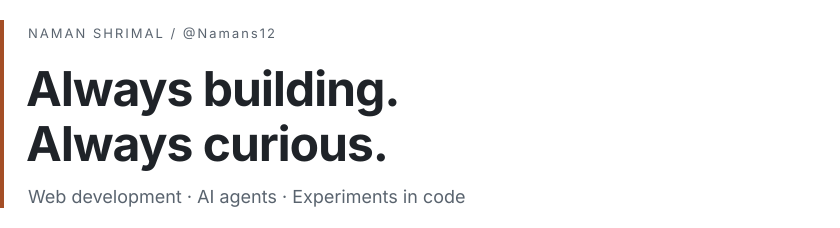

<!-- Saved Editorial direction for @Namans12. This file is a draft, not deployed. -->

<picture>
  <source media="(prefers-color-scheme: dark)" srcset="assets/header-dark.svg">
  
</picture>

 <a href="https://www.linkedin.com/in/naman-shrimal12/"><picture><source media="(prefers-color-scheme: dark)" srcset="assets/linkedin-dark.svg"></picture></a> <a href="mailto:Namanshrimal12@gmail.com"><picture><source media="(prefers-color-scheme: dark)" srcset="assets/email-dark.svg"></picture></a>

  

I make tools I want to use and explore ideas I want to understand. 
Lately, that means AI agents, memory, and better interfaces.

### A few things I've built

**[clip-clap ↗](https://github.com/namans1201/clip-clap)** 
Save, search, and organise your text snippets. 
Next.js · Supabase

---

**[notion-like ↗](https://github.com/namans1201/notion-like)** 
A block editor with slash commands and callouts. 
React · TypeScript

---

**[Agent memory ↗](https://github.com/namans1201/llm)** 
What should an agent keep, recall, or forget? 
Python · Neo4j · Groq

### Contributions

<!-- A preview only: this snake belongs to @namans1201. Generate @Namans12's own before deployment. -->
<picture>
  <source media="(prefers-color-scheme: dark)" srcset="https://raw.githubusercontent.com/namans1201/namans1201/output/snake-dark.svg">
  
</picture>
